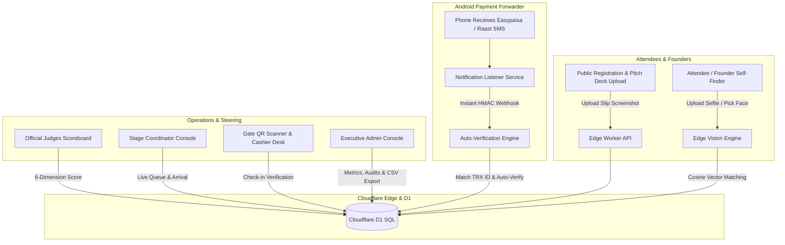

# 🏆 PitchPoint AI — Enterprise Venture Pitch, Judging & Multimodal Event Ecosystem

[](https://workers.cloudflare.com/)
[](https://developers.cloudflare.com/d1/)
[](https://opencv.org/)
[](./easypaisa_forwarder)
[](https://www.typescriptlang.org/)

**PitchPoint AI** is a complete, serverless campus venture competition and event orchestration platform built on **Cloudflare Edge Workers**, **Cloudflare D1**, and an accompanying **Android Real-Time Bank Synchronization Forwarder**. Originally engineered for the *Zindigi Prize Campus Rounds*, this repository provides a full-stack, battle-tested system capable of coordinating thousands of participants, live pitch queues, real-time banking verification, multi-judge scoring consensus, and attendee facial retrieval.

---

## 🏛️ System Architecture



---

## 🌟 Core Modules & Portals

| Portal / Route | Target Audience | Key Capabilities |
| :--- | :--- | :--- |
| **`/` (`ideacrux.html`)** | Founders & Public | Startup registration, pitch deck submissions, stall bookings, and live pass tracking. |
| **`/admin` (`crux-admin.html`)** | Venture Lead / Admin | Real-time financial telemetry, slip inspection zoom, unclaimed bank deposit matching, and staff permissions. |
| **`/judge` (`crux-judge.html`)** | Official Evaluators | 6-Dimension official criteria scoring (Idea, Solution, Business, Impact, Pitch, Judges), live leaderboards, and evaluator feedback. |
| **`/slots` (`crux-slots.html`)** | Stage Coordinator | Stage queue manager, team arrival toggles, projector presentation status, and 1-click WhatsApp alerts. |
| **`/ai-photos` (`ai-photos.html`)** | Attendees & Guests | Biometric face vector & outfit Re-ID engine. Finds all photos of an attendee across thousands of event assets in <50ms. |
| **`/scanner` (`scanner.html`)** | Turnstile Security | High-speed camera QR code ticket scanner with audio pass/fail verification and check-in audit logs. |
| **`/desk` (`crux-desk.html`)** | On-Spot Cashiers | Walk-in registration, cash collection shifts, physical badge generation, and register handovers. |

---

## 🚀 Beginner Quickstart (Never Used Cloudflare Before?)

You do **NOT** need any paid servers or DevOps experience. Cloudflare Workers and D1 provide a generous free tier that handles hundreds of thousands of requests effortlessly.

### Step 1: Install Node.js
Ensure you have **Node.js 18+** installed:
```bash
node -v
```

### Step 2: Clone & Install Dependencies
```bash
git clone https://github.com/MaajidJan/pitchpoint-event-portal.git
cd pitchpoint-event-portal
npm install
```

### Step 3: Login to Cloudflare (Free)
Run the Wrangler CLI login command:
```bash
npx wrangler login
```
*A browser window will open. Log in to your Cloudflare account (or create a free one) and click **Authorize**.*

### Step 4: Create Your Cloudflare D1 Database
Create your serverless SQLite database on Cloudflare with one command:
```bash
npx wrangler d1 create event-db
```
*Wrangler will output your unique `database_id`. Open `wrangler.jsonc` and paste this ID into `database_id`:*
```json
"d1_databases": [
  {
    "binding": "DB",
    "database_name": "event-db",
    "database_id": "PASTE_YOUR_DATABASE_ID_HERE"
  }
]
```

### Step 5: Execute Master Database Schema
Initialize all 14 relational tables (payments, teams, scores, AI vectors, feedback) instantly:
```bash
npx wrangler d1 execute event-db --remote --file=./schema.sql
```

### Step 6: Deploy Live to the World!
```bash
npx wrangler deploy
```
*Done! Your portal is instantly live with a free SSL domain (e.g. `https://pitchpoint-event-portal.YOUR-NAME.workers.dev`).*

---

## 📱 Mobile Payment Auto-Forwarder (Android)

To enable zero-touch payment reconciliation when attendees transfer funds via Easypaisa or Raast:
1. Open the [easypaisa_forwarder](./easypaisa_forwarder) folder.
2. Install `EasypaisaForwarder.apk` directly on your Android phone.
3. Grant **Notification Access** and set:
   * **Webhook URL**: `https://your-worker-subdomain.workers.dev/api/webhook/payment`
   * **Webhook Secret**: Matching your `WEBHOOK_SECRET` in `wrangler.jsonc`.
4. Tap **Save & Start Service**. Incoming bank transfers are automatically matched in real time.

---

## 🤖 Multimodal AI Vision & Outfit Re-ID Engine

The `/ai-photos` module employs a dual-stage biometric and appearance matching pipeline:
* **Facial Landmarks & 128-d Vector**: Evaluates inter-eye spacing, nose bridge curvature, and facial geometry using OpenCV YuNet and SFace models.
* **Torso / Outfit Re-ID Signature**: Because single-day event attendees wear identical attire throughout the day, the engine extracts a 128-bin HSV upper-body color histogram. When attendees turn their heads or look down, the outfit vector prevents false negatives.
* **Must-Not-Link Clustering**: Automatically guarantees that two faces detected in the same photograph can never be clustered into the same person.

---

## 🔒 Security & Data Hygiene
* **Zero Hardcoded Secrets**: All cryptographic keys, webhook tokens, and bank credentials are read dynamically from serverless environment variables.
* **PBKDF2 Password Hashing**: Administrative and judge accounts are protected via salted PBKDF2/SHA-256 password digests with constant-time equality checks.
* **Role-Based Access Control (RBAC)**: Enforced via serverless middleware (`ADMIN`, `JUDGE`, `FINANCE`, `CASHIER`, `GATE_SCANNER`, `STAGE_COORDINATOR`).
* **Tamper-Proof QR Signatures**: Ticket passes embed timestamped cryptographic hashes verifying authenticity against the database.

---

## 📄 License
This project is open-source under the [MIT License](LICENSE). Contributions, forks, and institutional adaptations are welcome!
